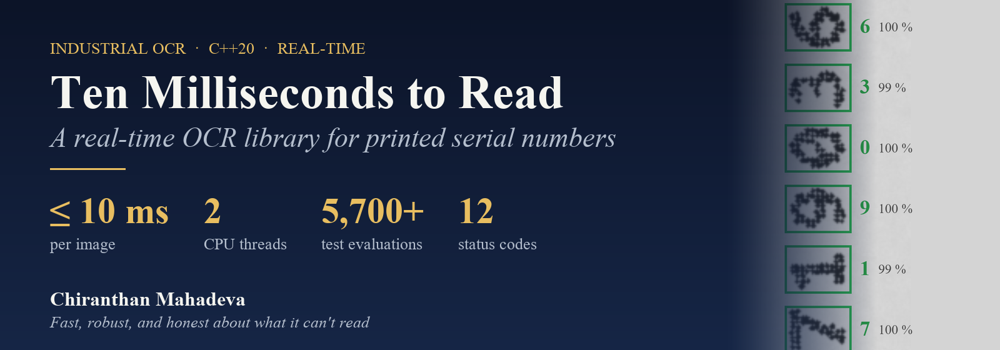
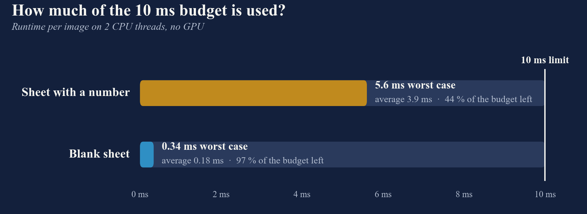
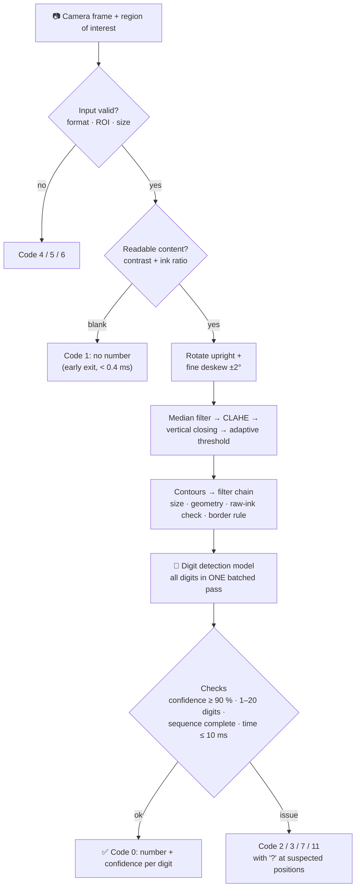
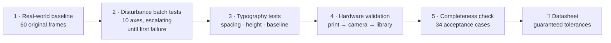
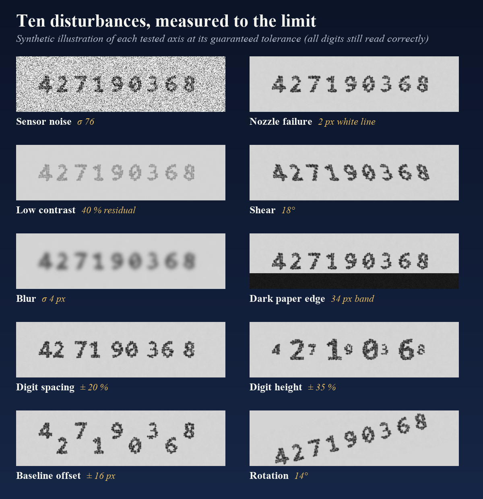

  

  
  
  
  

  <b>A production C++ library that reads inkjet-printed serial numbers (1–20 digits) straight from camera frames, 
  within 10 ms per image on two CPU threads, and returns a clear status code whenever it can't.</b>

> **Source code is private.** This is an industrial customer project. This page shows *what* was built, how it was tested and what it achieved. The code itself isn't published.

---

## 🎯 The challenge

Every sheet in a high-speed production line carries a printed serial number. A camera captures each sheet, and the number has to be read **before the next sheet arrives**:

| Requirement | Target |
|---|---|
| ⏱️ Processing time | **≤ 10 ms per image**, enforced by the library itself |
| 🧮 Compute | **max. 2 CPU threads, no GPU**, on an industrial PC |
| 🔢 Number | 1–20 digits, printed rotated 90° on the sheet |
| ✅ Confidence | every digit ≥ 90 %, otherwise flagged |
| 🛡️ Reliability | no crashes, no exceptions, **no silent wrong reads**. Every outcome has a status code. |
| 🧩 Integration | C++20 library with a small API, documented error codes, logging hooks |

## 📊 Results at a glance

Measured on 60 original production frames: 26 sheets with a number and 34 blank sheets.

| | Result |
|---|---|
| Original production frames with a number | **26 / 26 read correctly**, every digit ≥ 99 % confidence |
| Blank sheets | **34 / 34 correctly reported as "no number"**, with zero phantom digits |
| Runtime with a number | **3.1–5.6 ms** (mean 3.9 ms), on 2 threads, under the 10 ms budget |
| Runtime on blank sheets | **0.12–0.34 ms**, thanks to an early-exit content check |
| Automated test evaluations | **5,700+** across 10 disturbance axes, typography, hardware and completeness tests |
| Completeness check | **34 / 34 PASS**: missing digits are flagged, never silently dropped |

## ⚙️ How it works

### What made 10 ms on 2 cores possible
- **Work only on the region of interest**: the full camera frame is never processed.
- **Early exit for blank sheets**: a cheap contrast and ink-ratio check rejects empty paper in well under a millisecond.
- **Classic CV to find, a compact model to read**: OpenCV finds the digit candidates, and a small digit detection model reads them.
- **One batched inference call**: all digit crops go through the network together instead of one call per digit.
- **Fixed thread budget**: OpenCV is limited to two threads, the build is fully optimised (`/O2`, C++20), and there's a warm-up call to initialise the inference engine.
- **Measure the right thing**: an early measurement showed 75–144 ms, most of which turned out to be **console output and visualisation**. Timing only the library call showed the algorithm itself runs in single-digit milliseconds.

## 🛡️ Never silently wrong

The hardest part wasn't speed. It was making sure the library **never returns a confident wrong answer**:

- **"Phantom digits"**: a faint paper crease was amplified by contrast enhancement into digit-like strokes, and the detection model read them as digits with high confidence. Fixed by a **raw-ink verification** on the *unenhanced* image: every digit candidate must contain real dark pixels.
- **"Silent shortening"**: a digit lost to a print defect used to produce a shorter number with a success status. A **sequence-completeness check** now looks for gaps in the digit pitch and for discarded ink-bearing candidates, and returns `Code 2` with a `?` at the suspected position (for example `42719?368`).
- **12 status codes** cover every exit path, so the integrating machine always knows *why* a sheet wasn't read:

| Code | Status | Code | Status |
|:--:|---|:--:|---|
| 0 | Success | 6 | Invalid ROI |
| 1 | No number found | 7 | Too many digits |
| 2 | Number not recognisable | 8 | Model not loaded |
| 3 | Low confidence | 9 | Inference failed |
| 4 | Invalid input | 10 | Processing failed |
| 5 | Unsupported image format | 11 | Runtime exceeded |

## 🧪 How it was tested

1. **Real-world baseline**: every original camera frame evaluated unmodified, with the full result logged (number, status, confidence per digit, runtime).
2. **Automated batch testing**: a built-in performance tester **increases each disturbance step by step** on every reference number until the first failure. The last fully correct level becomes the **guaranteed tolerance**, and every run produces a detailed report.
3. **Typography tests**: digits are re-laid out with alternating spacing, height and baseline offsets, the worst case for the reader.
4. **Hardware validation**: test sheets are printed at the measured software limits, captured with the real camera rig and read again. This confirms the limits hold through the physical print → camera chain.
5. **Completeness acceptance**: all clean numbers must stay `Code 0` with zero flags, and all known dropout cases must be flagged.

### Measured robustness: the guaranteed tolerances

| Disturbance | Guaranteed tolerance (all reference numbers read correctly) |
|---|---|
| Sensor noise | σ 76 |
| Nozzle failure (white line) | 2 px ≈ 0.22 mm |
| Low contrast | 40 % residual contrast |
| Blur | σ 4 px ≈ 0.43 mm |
| Shear | 18° (spec ± 2°, so about 9× reserve) |
| Rotation | 14° (spec ± 2°, so 7× reserve) |
| Dark paper edge | 34 px ≈ 3.7 mm |
| Digit spacing | ± 20 % |
| Digit height | ± 35 % |
| Baseline offset | ± 16 px ≈ 1.7 mm |

Beyond each limit the library **degrades gracefully**: it reports low confidence (`Code 3`) or flags missing digits (`Code 2`) instead of returning a wrong number with a success status.

The images above are synthetic illustrations with a made-up number. All measured values come from the real test campaign.

## 🧰 Tech stack

**C++20** · **OpenCV** (CLAHE, adaptive threshold, morphology, contours) · compact **digit detection model** · Visual Studio 2019 toolset (v142), `/O2` · industrial GigE mono camera, ~235 dpi · Excel/CSV test reporting · bilingual (EN/DE) datasheet, integration guide and test guide

## 💡 Lessons learned

1. **Profile the call, not the program**: console output and visualisation can make a fast algorithm look slow.
2. **A confident wrong answer is the worst outcome**: invest in guards, completeness checks and explicit status codes.
3. **Verify against the raw image**: contrast enhancement helps segmentation, but it can also invent structure.
4. **Test to the breaking point**: escalating disturbance tests turn "it works" into **guaranteed, documented limits**.
5. **Close the loop with hardware**: software limits only count once they survive the real print → camera chain.

---

  <b>Chiranthan Mahadeva</b> · Industrial machine vision & AI 
  More: <a href="https://github.com/Gojoinferno/MachineVision-Research">MachineVision-Research</a> ·
  <a href="https://github.com/Gojoinferno/VirtualReality-HapticGlove">VirtualReality-HapticGlove</a> ·
  <a href="https://github.com/Gojoinferno/STM32-SecureEEPROM">STM32-SecureEEPROM</a>

